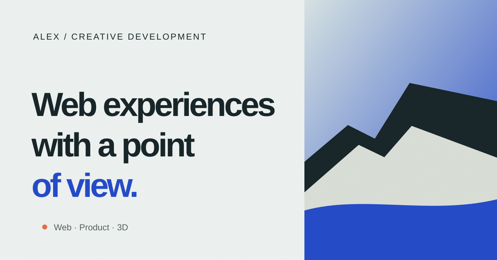
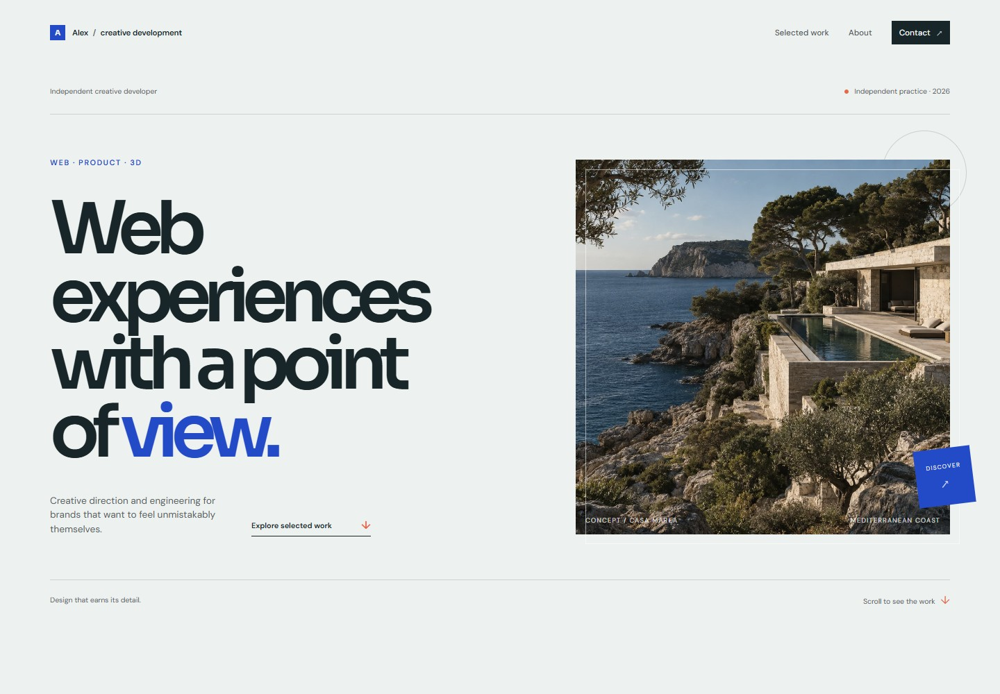
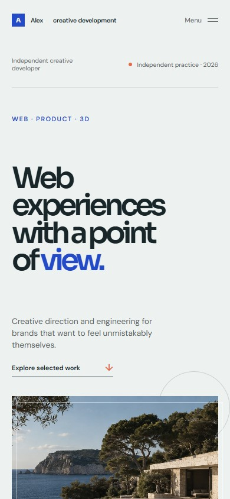
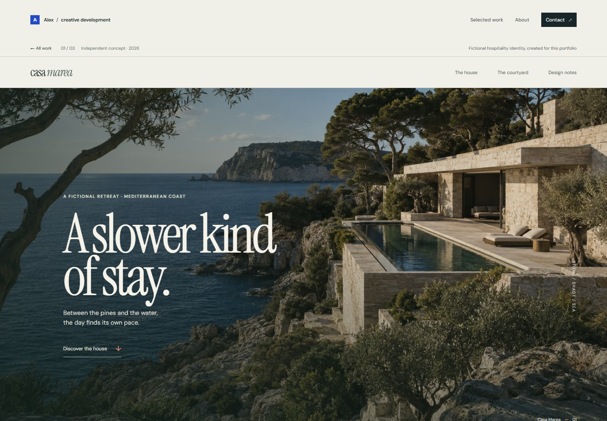
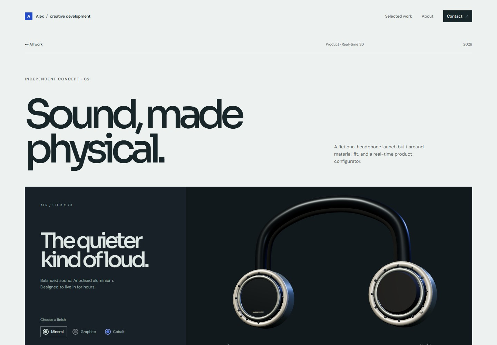
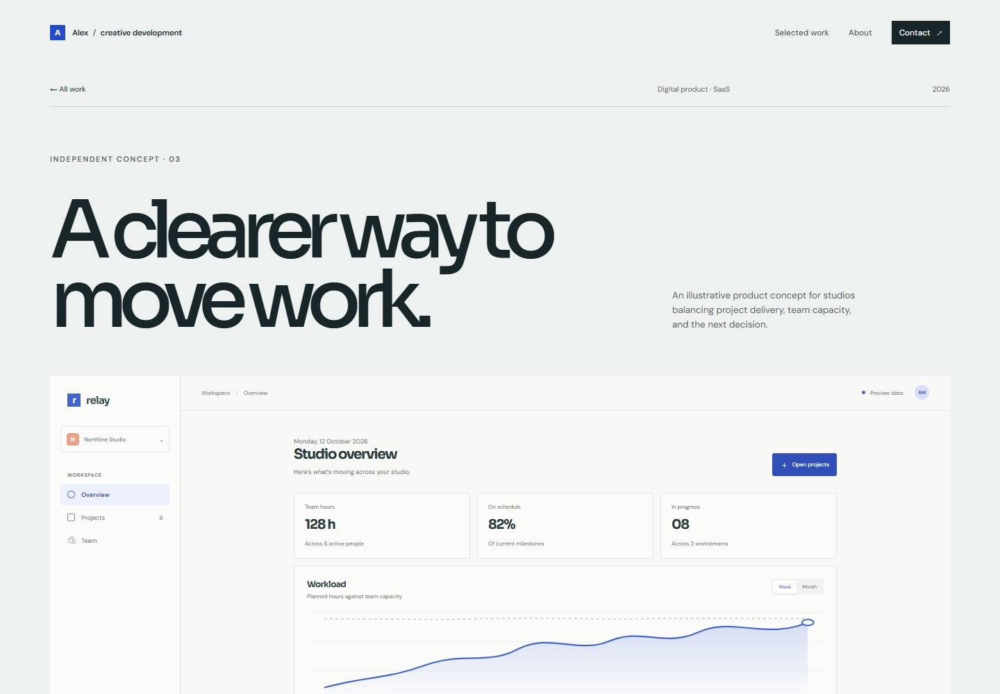
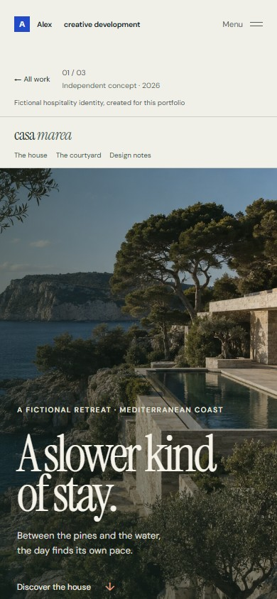
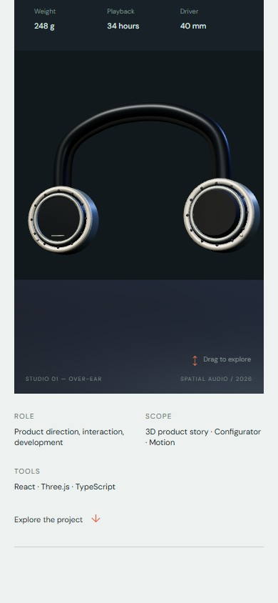
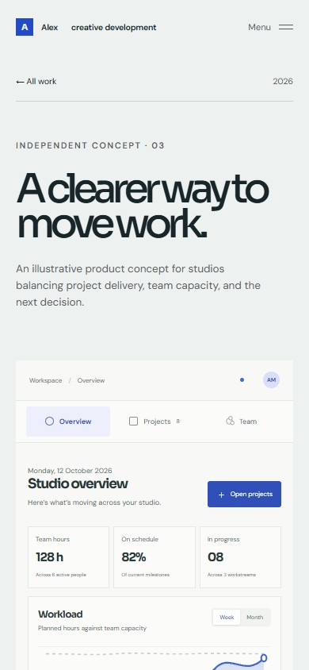

# Alex / Creative development

An art-directed developer portfolio for a freelance creative developer working across identity, interactive web, product interfaces, and real-time 3D.



## What is here

The site is a small, fully client-side React experience with three independent concept projects:

- **Casa Marea** — a fictional boutique-hotel identity with its own image-led landing page, in-page navigation, and editorial case-study notes.
- **AER** — a headphone product launch with a procedural Three.js configurator, drag rotation, material finishes, loading fallback, and a mobile camera treatment.
- **Relay** — an illustrative studio operations product with separate overview, projects, and team views, a workload chart, and week/month controls.

The concepts are fictional and labelled as such. Interface figures are illustrative; the site does not imply real clients, revenue, conversions, or live product data.

## Highlights

- A dedicated Casa Marea brand page that tells a complete visual story and then explains the concept, design direction, interaction, role, and outcome.
- Distinct visual language for each case study instead of a repeated card template.
- Route-level lazy loading for the homepage and case studies.
- AER's Three.js renderer is dynamically imported only on its case-study route; the homepage and other project pages do not load WebGL code.
- Original Casa Marea architectural imagery generated for this project and stored locally in `public/images/` as optimized WebP assets.
- Responsive layouts for desktop, tablet, and mobile, including a deliberately simplified mobile product framing and section navigation inside the Relay dashboard.
- Keyboard-visible focus states, semantic landmarks, skip link, descriptive image alt text, and `prefers-reduced-motion` support.
- Motion is used for reveal, hover, navigation, and direct manipulation rather than as decoration over static content.

## Stack

- React 19 + TypeScript
- Vite 8
- React Router
- Three.js (procedural AER product model)
- CSS with local design tokens, shared component styles, and page-specific style sheets
- Google Fonts: Sora, DM Sans, Instrument Serif

## Run locally

Use Node.js 20.19 or newer in the 20.x line, or 22.12 or newer. These versions meet the Vite 8 engine requirement.

```bash
npm install
npm run dev
```

Open the local Vite URL shown in the terminal. To build and preview the production output:

```bash
npm run build
npm run preview
```

## Project structure

```text
src/
  components/       Shared shell, artwork, dashboard, reveals
  content/          Typed case-study content
  pages/            Homepage, case studies, bespoke Casa Marea page, not-found route
  styles/           Design tokens and responsive visual system
  three/            Lazy-loaded AER WebGL experience
public/
  images/           Original Casa Marea assets
  favicon.svg       Site icon
  og-preview.svg    Social preview artwork
screenshots/        Desktop and mobile QA captures
```

## Routes

- `/` — portfolio home, selected projects, capabilities, about, and contact sections.
- `/work/casa-marea` — the bespoke Casa Marea landing page and design study.
- `/work/aer` — the AER product story and procedural 3D configurator.
- `/work/relay` — the Relay dashboard concept with interactive Overview, Projects, and Team views.

## Architecture notes

The typed project model supplies the home index, route-level case studies, and next-project navigation. The shared case-study route uses project-specific content and artwork; Casa Marea has a bespoke landing page, while AER loads its dedicated `HeadphoneExperience` module and Three.js chunk only when needed. Project presentation stays out of the shared site shell.

Relay keeps its interaction surface local to the prototype. Its section navigation changes between overview, project list, and team capacity views; the week/month selector updates the workload chart and the matching hours, capacity, and availability figures. Progress bars and sample metrics are illustrative and are not connected to a service.

Casa Marea uses anchored navigation, original local imagery, and a separate design-study section. Its desktop and mobile captures show the brand page; the Relay mobile capture is framed on its dashboard so the in-product navigation is visible.

## Performance notes

`npm run build` runs TypeScript checking and produces the production site. In the latest build, the AER configurator module is 10.64 kB minified (3.87 kB gzip), and the deferred Three.js chunk is 551.57 kB minified (137.51 kB gzip). Vite reports the Three.js chunk because it exceeds the 500 kB minified warning threshold. It is requested only when the AER case study mounts; the homepage, Casa Marea, and Relay do not request it. The WebGL renderer caps device pixel ratio, requests a low-power context, pauses while the document is hidden, and falls back to a static product illustration if WebGL cannot initialize.

## Visual QA

The production preview was rendered at 1440 × 1000 desktop and 390 × 844 mobile viewports for the homepage and all three project routes. Responsive layout was measured at 17 widths from 320 to 1440 px across all four routes (68 route-width checks); the document and body widths matched each viewport with no horizontal overflow. The browser console had no errors on any route.

The mobile menu and Escape/focus return, Casa Marea section links, AER finish selection and drag rotation, and Relay section and week/month controls were exercised. The AER mobile capture is framed on its product view to show the procedural 3D model.

## Live demo

This repository has no public deployment yet. To preview the site locally, use the commands in [Run locally](#run-locally).

## Screenshots

Screenshots were captured from the production preview at 1440 × 1000 desktop and 390 × 844 mobile viewports.

### Home




### Project pages





<details>
<summary>Mobile project captures</summary>




</details>

`public/og-preview.svg` is a lightweight social preview. The original architectural assets used in the experience live in `public/images/casa-marea.webp` and `public/images/casa-marea-courtyard.webp`.
